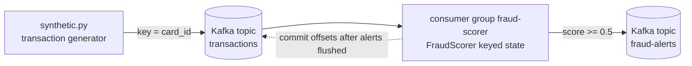

# Real-Time Fraud Alerts with Kafka (Stateful Streaming Rules)

> **Representative portfolio project.** Independently written with synthetic card transactions. It is not code from, and does not describe the systems of, any employer or client.

Card transactions are published to a Kafka topic keyed by card. A consumer keeps per-card state, scores each transaction against four rules, and publishes alerts to a second topic for investigators.

## Business problem

Fraud teams need suspicious activity flagged within seconds, with a reason an analyst can act on, and without flooding the queue with false positives.

## Architecture



| Rule | Logic | Weight |
|---|---|---|
| `velocity` | more than 3 transactions on a card within 10 minutes | 0.6 |
| `amount_outlier` | amount more than 4 standard deviations above the card's running mean (Welford), after 5 transactions of history | 0.6 |
| `geo_jump` | country changes within 60 minutes | 0.6 |
| `high_risk_merchant` | gift cards / crypto / wire at $900 or more | 0.5 |

Design choices worth noting:
- **Keyed by card** so all events for one card land on one partition and keep their order.
- **At-least-once delivery**: offsets are committed only after alerts are flushed. Alerts can repeat after a crash, so downstream should de-duplicate on `txn_id`.
- **Outliers do not update the baseline**, so a fraudster cannot inflate the card's "normal" amount.
- **Bad messages are logged and skipped** instead of stopping the consumer.

## Run it

```bash
pip install -e ".[dev,kafka]"
pytest -q                                   # rule tests, no broker needed
python -m fraud_stream.evaluate 20000       # offline replay with precision / recall

docker compose up -d                        # single-node Kafka (KRaft)
cp .env.example .env                        # broker + topic names
python -m fraud_stream.kafka_io consume &   # scorer
python -m fraud_stream.kafka_io produce     # publish 5,000 synthetic transactions
```

## Sample output

Offline replay of 20,000 synthetic transactions (`docs/sample_evaluation.json`):

```json
{"alerts": 386, "true_positives": 330, "false_positives": 56, "missed": 187,
 "precision": 0.855, "recall": 0.638,
 "alerts_by_reason": {"velocity": 211, "amount_outlier": 119, "geo_jump": 54, "high_risk_merchant": 45}}
```

Recall is capped by design: in a burst of 7 transactions, the first 3 look normal until the velocity threshold is crossed. These numbers describe synthetic data only and say nothing about real-world fraud performance.

## Tests

`tests/test_rules.py` covers each rule, state isolation between cards, protection of the baseline from outliers, bad-message handling, and a precision/recall floor on the replay. CI runs lint and tests on every push. The Kafka I/O path is exercised manually with Docker Compose and is not part of CI.

## Security notes

- No real card numbers; IDs are synthetic (`card_00042`).
- Broker settings come from environment variables. For a secured cluster, add SASL/SSL settings through the environment or a secret manager, never in code.

## Limitations and next steps

- State is in memory; production would use Kafka Streams / Flink state stores or Spark Structured Streaming with checkpointing.
- Rules and weights are hand-set; a next step is to log features and train a model offline.
- Add a dead-letter topic for unparseable messages.

## License

MIT
